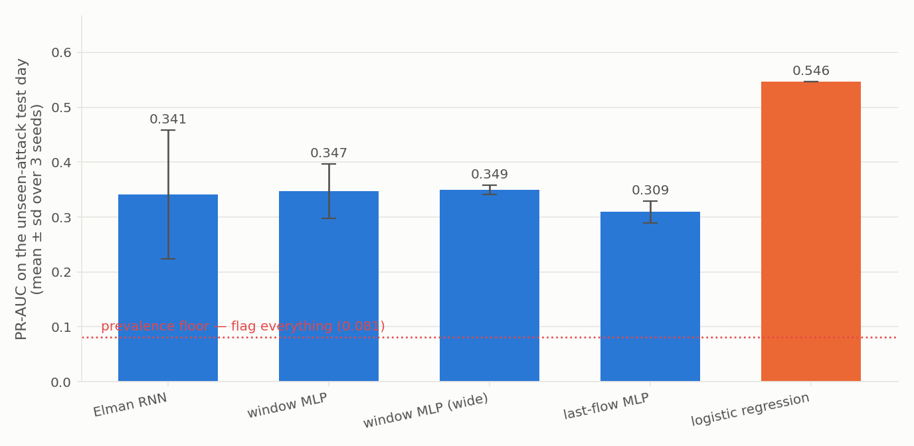
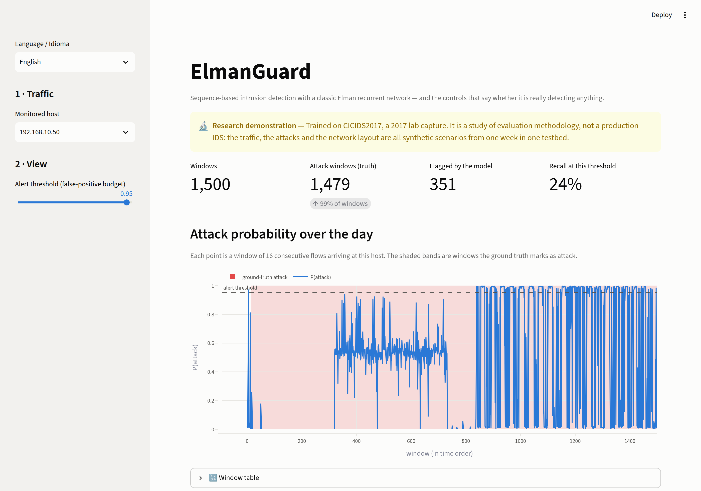
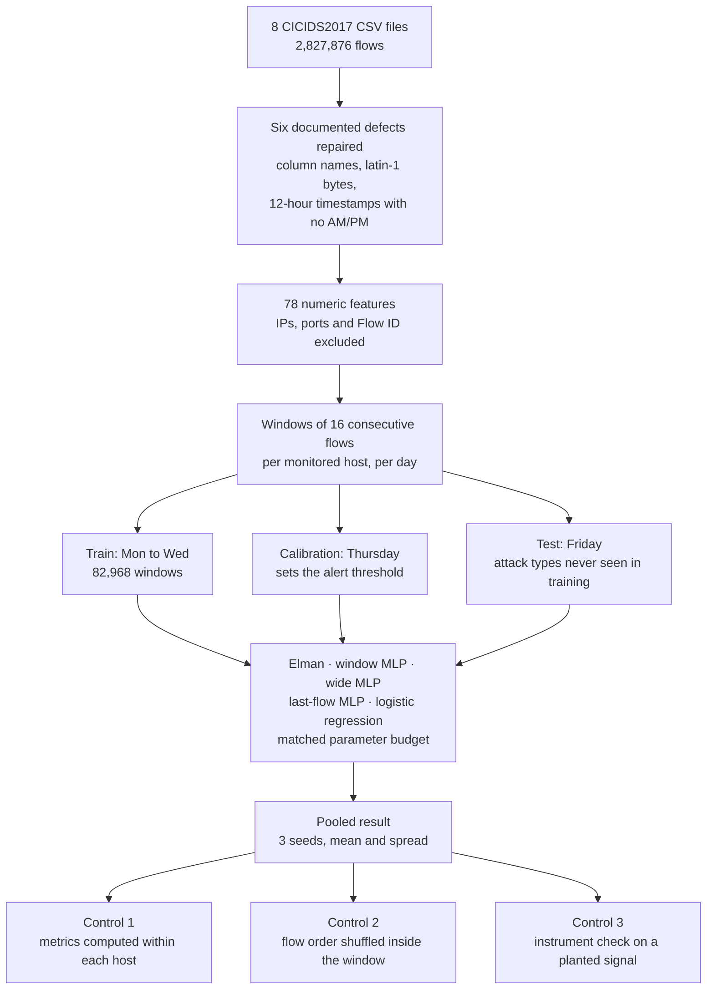
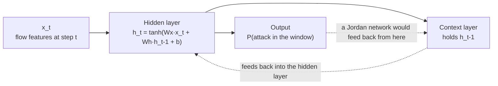
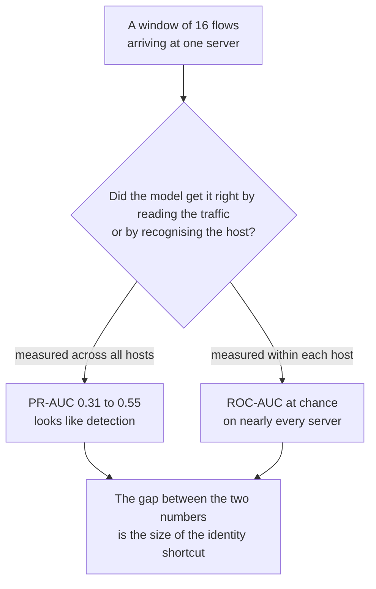
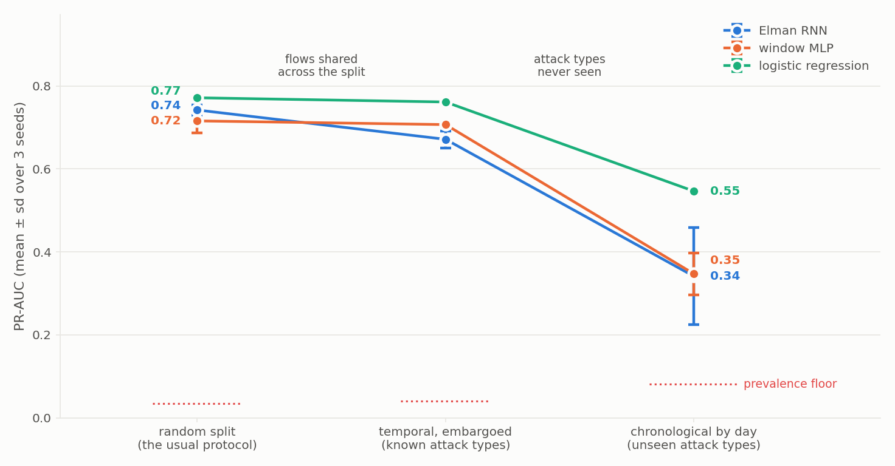
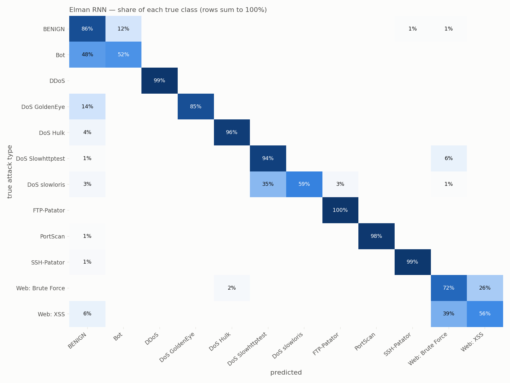

<h1 align="center">ElmanGuard</h1>

<p align="center">
  <strong>Sequence-based intrusion detection with a classic Elman recurrent network — and the controls that say whether it is really detecting anything.</strong>
</p>

<p align="center">
  
  
  <a href="https://elman-guard-apps4fvjn5n5fsk4kb9v2wv.streamlit.app/"></a>
  
  
  <a href="https://github.com/AlanFMF/elman-guard/actions/workflows/tests.yml"></a>
</p>

<p align="center"><strong><a href="https://elman-guard-apps4fvjn5n5fsk4kb9v2wv.streamlit.app/">▶ Open the live app</a></strong> · <a href="README.md">🇧🇷 Leia em português</a></p>

---

An Elman network reads a window of 16 consecutive network flows arriving at a
monitored server and predicts whether that window contains an attack. Trained on
Monday–Wednesday of CICIDS2017, thresholded on Thursday, evaluated on Friday —
whose attack types it has never seen.

The point of the repository is not the detector. It is the four controls around
it, and what they reveal.

## Five findings

**1 · For detection, temporal order carries no measurable signal — and that null is credible.**
Shuffling the flows inside every window destroys the order while keeping the
contents. The Elman's PR-AUC falls by **0.055**; the seed-to-seed standard
deviation of the same measurement is **0.117**. The effect is smaller than the
noise. What makes this worth stating is the instrument check below: the same
harness detects a *planted* temporal signal at PR-AUC 0.985.

**2 · Faced with an unseen attack type, almost all of the apparent skill is host recognition.**
Pooled across servers the models reach PR-AUC 0.31–0.55. Computed *inside* each
host — where "which machine is this" carries no information — every neural model
sits at or below chance. Only a logistic regression on the heavily attacked server
clears it, at ROC-AUC 0.694. **With attack types already seen, the verdict flips:**
inside the same server, detection is real, at ROC-AUC 0.82 to 0.93.

**3 · A linear model beats the neural networks under every protocol tested.**
Logistic regression has the highest PR-AUC under all three detection protocols and
the highest macro-F1 on the multiclass task. For detection, the four networks are
indistinguishable — the gap between them is smaller than one network's own spread
across seeds.

**4 · The protocol decides the number — and leakage is the smaller part of the inflation.**
The random split leaves training flows in 66% of test windows, yet that is worth
only ~0.01 PR-AUC for the MLP and the logistic regression. What really inflates
the score is testing only attack types already known: 0.21 to 0.36.

**5 · To name the attack, the Elman beats the MLP — but not through memory.**
On the multiclass task it outscores its non-recurrent counterpart by 0.08
macro-F1, and the lead survives whole when flow order is destroyed. What it has
over the MLP is weight sharing across the window, not memory of the sequence.



<details>
<summary><strong>The app</strong> (click to expand)</summary>



**[Open the app](https://elman-guard-apps4fvjn5n5fsk4kb9v2wv.streamlit.app/)** and pick another server or move the threshold. If it is
asleep (the free tier stops apps nobody has visited), click to wake it and give it a
minute. The app opens in Portuguese; switch to English in the sidebar.

The test day at the attacked server. The whole day is shaded because 98.6% of its
windows contain attack traffic — and the model's probability spends long stretches
near zero inside it. That picture is the within-host control, drawn.

</details>

## The setup

| | |
|---|---|
| Data | CICIDS2017 `TrafficLabelling`, all 8 day files, **2,827,876 flows** after repair |
| Features | **78** numeric flow statistics; IPs, ports, `Flow ID` and timestamp excluded |
| Sample | 16 consecutive flows arriving at one monitored host, on one day |
| Split | train Mon–Wed (82,968 windows, 3.2% attack) · threshold Thu (29,955, 1.1%) · test Fri (23,858, 8.1%) |
| Test attacks | PortScan, DDoS, Bot — **none of them seen in training** |
| Repeats | every number below is the mean ± sd over 3 seeds |

## Architecture

The path a network flow takes to become a number in this README:



| Stage | What happens | Why it matters |
|---|---|---|
| Repair | Six defects in the published CSVs are fixed, each with a test | Without it the file barely loads, and two of them corrupt time itself |
| Features | IPs, ports, `Flow ID` and timestamp leave the matrix | In this capture the attacker's IP **is** the label |
| Sequences | 16 consecutive flows from one host, on one day | Grouping by host stops the network learning "what time of day is it"; never crossing a day stops the split from leaking |
| Split | Chronological, by weekday | Each day holds different attacks, so the test measures generalisation to unseen types |
| Models | Five, at a matched parameter budget | Isolates architecture from capacity |
| Controls | Three, applied to the result | This is what separates detection from recognition, and signal from noise |

### The Elman network

The context layer holds the hidden activation from the previous step and feeds it
back as extra input. Its sibling, the Jordan network, feeds back the *output*
layer instead — the difference is where the dotted arrow starts:



### The shortcut the controls hunt for

Almost every attack in CICIDS2017 leaves one host and lands on one server. That
opens a path by which a model scores well while detecting nothing:



## Results

PR-AUC on the unseen-attack test day. The prevalence floor — what a detector
that flags everything would score — is 0.081.

| model | PR-AUC | ROC-AUC | recall @ 1% FPR | precision | params |
|---|---|---|---|---|---|
| **logistic regression** | **0.546** | 0.775 | **0.468** | 0.825 | 19,969 |
| window MLP (wide) | 0.349 ± 0.008 | 0.601 | 0.258 ± 0.019 | 0.822 | 80,001 |
| window MLP | 0.347 ± 0.050 | 0.603 | 0.155 ± 0.124 | 0.841 | 8,751 |
| **Elman RNN** | 0.341 ± 0.117 | 0.638 | 0.177 ± 0.097 | 0.815 | 9,217 |
| last-flow MLP | 0.309 ± 0.020 | 0.758 | 0.174 ± 0.056 | 0.767 | 9,201 |
| prevalence floor | 0.081 | 0.500 | — | 0.081 | — |

The four neural models span 0.309 to 0.349 — a range narrower than the Elman's
own standard deviation across seeds. **Any paper reporting that its RNN beats an
MLP by two points on CICIDS2017 is reporting the seed.**

Recall by attack type tells you where the 0.55 comes from:

| attack (unseen) | Elman | window MLP | logistic |
|---|---|---|---|
| DDoS | 0.530 | 0.684 | 0.808 |
| PortScan | 0.000 | 0.000 | 0.431 |
| Bot | 0.000 | 0.000 | 0.036 |

DDoS transfers because the training days are full of DoS. PortScan and Bot do
not transfer at all for the neural models. This is what "generalises to unseen
attack types" actually looks like.

## The controls

### 1 · Within-host: how much is recognition?

Pooled across servers, a model can score well simply by learning *which machines
get attacked* — in this capture the web server is under attack 95% of the week
and the other hosts essentially never are. Inside one host that information is
constant, so within-host numbers measure detection.

ROC-AUC, test day, per monitored host (0.5 = chance):

| host | attack rate | Elman | window MLP | logistic |
|---|---|---|---|---|
| 192.168.10.50 | 98.6% | 0.561 | 0.451 | **0.694** |
| 192.168.10.9 | 13.8% | 0.426 | 0.399 | 0.509 |
| 192.168.10.15 | 8.0% | 0.483 | 0.340 | 0.328 |
| 192.168.10.5 | 4.9% | 0.417 | 0.360 | 0.415 |
| 192.168.10.14 | 4.3% | 0.316 | 0.192 | 0.303 |
| 192.168.10.8 | 3.5% | 0.464 | 0.266 | 0.341 |
| 205.174.165.73 | 56.9% | 0.220 | 0.100 | 0.195 |

Read across: **the pooled PR-AUC of 0.34–0.55 is very largely host identity.**
Strip it out and one cell in the table beats chance.

### 2 · Order shuffle: is the recurrence earning its place?

| model | PR-AUC ordered | PR-AUC shuffled | drop | seed sd |
|---|---|---|---|---|
| Elman RNN | 0.341 ± 0.117 | 0.286 ± 0.039 | 0.055 | 0.117 |
| window MLP | 0.347 ± 0.050 | 0.305 ± 0.024 | 0.042 | 0.050 |

Both drops are smaller than the run-to-run spread. At the flow-window level on
this capture, the order of flows is not carrying information the models can use.

### 3 · The instrument check — the control that saved the project

A null result is worthless unless the instrument can detect a positive one.
`synthetic.order_only_dataset` builds windows where **order is the only signal**:
every window comes from the same AR(1) process, negatives are the same values
permuted in time, so mean, variance, min, max and even the last-step distribution
are identical between classes.

| configuration | PR-AUC on the order-only probe |
|---|---|
| earlier default (48 units, dropout 0.3, lr 1e-3) | **0.483** — chance |
| current default (64 units, dropout 0.2, lr 3e-3) | **0.985** |

The first configuration would have produced a confident, published, and
completely false conclusion: *"the recurrence adds nothing."* It was not a
finding, it was an undertrained network. The probe is now a test
(`tests/test_harness_detects_planted_signal.py`) that fails if the harness ever
loses the ability to see a temporal effect.

A second reproducibility bug surfaced the same way: seeding inside `fit` but not
before the weights were built made two runs of the same configuration differ by
more than 0.25 PR-AUC. Hence three seeds on every number.

### 4 · Grouping by source instead of destination

Nearly every attack flow in CICIDS2017 comes from one host, `172.16.0.1`, whose
traffic is **99.4% attack**. Group sequences by source and the question silently
becomes "is this the attacker's machine". Measured, single run:

| grouping | PR-AUC | precision |
|---|---|---|
| by destination (monitored server) | 0.470 | 0.815 |
| by source | 0.291 | **1.000** |

I expected source-grouping to inflate PR-AUC and it did not; what it does is push
precision to a perfect 1.000, which is the fingerprint of a model that has found
an identity shortcut and fires only when it is certain. Reported as measured
rather than as predicted.

## The protocol decides the number

The same models, on the same windows, scored three ways:

| protocol | what separates train from test | test windows holding a training flow |
|---|---|---|
| **random** | shuffled windows — the protocol most published results use | **66%** |
| **temporal, embargoed** | every attack burst cut in time; any window sharing a flow across the boundary is dropped | 0% |
| **chronological** | train Monday to Wednesday, test Friday | 0%, by construction |



| model | random | temporal | chronological |
|---|---|---|---|
| logistic regression | 0.772 | 0.761 | 0.546 |
| Elman RNN | 0.742 ± 0.012 | 0.671 ± 0.021 | 0.341 ± 0.117 |
| window MLP | 0.716 ± 0.029 | 0.707 ± 0.005 | 0.347 ± 0.050 |
| prevalence floor | 0.035 | 0.040 | 0.081 |

**Inflation has two causes, and the one usually blamed is the smaller.** The leak
is real — two thirds of the random split's test windows contain at least one flow
the model trained on — but it is cheap: about 0.01 PR-AUC for the MLP and the
logistic regression. The big step is the next one. Testing only attack types the
model already knows, instead of unseen ones, is worth **0.21 to 0.36**. A random
split on CICIDS2017 does not measure intrusion detection; it measures recognition
of catalogued attacks.

**The recurrent network profits most from the leak.** When the embargo goes in,
the Elman loses 0.07 — about three standard deviations — while the MLP's drop is
within noise. Overlapping windows share a run of eight flows, and the model that
reads sequences is exactly the one that gains most from having seen it already.

**And the within-host control changes its verdict.** Inside the attacked server
(`192.168.10.50`), with known attack types, detection is real: ROC-AUC 0.82
(Elman), 0.84 (MLP) and 0.93 (logistic). With unseen types it falls to 0.56, 0.45
and 0.69. So the conclusion that "the skill is host recognition" holds for attacks
never seen before. When the type is known, the models read the traffic.

What the temporal protocol does **not** guarantee: it is not chronological across
classes. Benign traffic from late in a day can train a model tested on an attack
from earlier that day. It guarantees that no flow is seen on both sides — and that,
within each attack type, the test comes after the training.

## Multiclass: which attack is it?

Detection answers "is something wrong in this window?". The next question an
IDS operator asks is *what*. Same discipline as the binary task: matched parameter
budgets, three seeds, a linear baseline and the order ablation.

Two choices are forced by the data:

- **The protocol is the temporal, embargoed one.** On the chronological split the
  test day only holds types never seen in training — and no classifier can name a
  class it was never shown.
- **The window cap is applied per attack type.** With the proportional cap used
  for detection, a minority attack on a busy server kept only a few dozen windows.
  Even so, three types fall short of the 60-window minimum — Heartbleed (5
  windows), Infiltration (5) and SQL injection (6) — and leave the task, listed in
  the report.

That leaves **12 classes** — benign traffic and 11 attack types — and no test
window shares a flow with training. The headline metric is **macro-F1**, where
every type weighs the same: a model cannot score well by being right about benign
traffic and DoS Hulk alone.

| model | macro-F1 | balanced accuracy | weighted F1 |
|---|---|---|---|
| logistic regression | **0.749** | 0.788 | 0.960 |
| Elman RNN | 0.711 ± 0.022 | **0.843 ± 0.012** | 0.926 ± 0.011 |
| window MLP | 0.630 ± 0.022 | 0.807 ± 0.009 | 0.914 ± 0.006 |



**Here the recurrent network beats its non-recurrent counterpart** — by 0.08
macro-F1, nearly four standard deviations, at the same parameter budget. It is the
first task in this project where that happens.

**But not because of order.** Shuffling the flows inside every window does not
bring the Elman down — and its lead over the MLP survives whole:

| model | macro-F1, real order | macro-F1, shuffled | difference |
|---|---|---|---|
| Elman RNN | 0.711 ± 0.022 | 0.722 ± 0.013 | +0.011 |
| window MLP | 0.630 ± 0.022 | 0.607 ± 0.039 | −0.023 |

Both differences are within noise. What fits is a structural explanation, not a
temporal one: the recurrent layer applies **the same weights** to each of the 16
flows, while the flattened MLP, on the same budget, has to learn separate weights
for every position — and is left with only 8 hidden units to do it. The Elman wins
by *sharing* weights across the window, not by *remembering* the sequence. That is a
hypothesis: the ablation rules out order as the cause, but does not test weight
sharing directly.

**The logistic regression still has the highest macro-F1, but the Elman gets more
of each class right.** Balanced accuracy is the mean per-class recall, and there
the Elman leads (0.843 against 0.788). Macro-F1 also punishes precision, and that
is where it loses: 12% of benign windows are labelled "Bot". With 23 thousand
benign test windows and only 67 Bot ones, those false alarms drown the whole class
— Bot scores an F1 of 0.03 for every model.

**The errors fall where an analyst would expect them.** Apart from Bot, which
blends into normal traffic, and GoldenEye, read as benign in 14% of windows, the
confusions stay inside an attack family:

- **slowloris → Slowhttptest (35%)**. Both are "slow" DoS attacks that hold HTTP
  connections open with almost no traffic. At flow level they are nearly the same
  gesture.
- **web brute force ↔ XSS (26% and 39%)**. Both hit the same web application, on
  the same port, with similar HTTP requests.
- **Bot ↔ benign (48%)**. Half of the Bot traffic passes for normal — which is
  exactly what a well-built bot tries to look like.

The model gets the species wrong far more often than the genus. Per-type F1, mean
over three seeds:

| attack type | Elman | window MLP | logistic |
|---|---|---|---|
| benign | 0.934 | 0.929 | 0.969 |
| DDoS | 0.988 | 0.944 | 0.992 |
| PortScan | 0.988 | 0.953 | 0.986 |
| FTP-Patator | 0.953 | 0.857 | 0.981 |
| DoS GoldenEye | 0.882 | 0.763 | 0.900 |
| DoS Hulk | **0.838** | 0.671 | 0.766 |
| SSH-Patator | 0.709 | 0.592 | 0.878 |
| DoS Slowhttptest | 0.674 | 0.634 | 0.715 |
| DoS slowloris | 0.643 | 0.555 | 0.697 |
| Web: XSS | **0.451** | 0.431 | 0.426 |
| Web: brute force | 0.441 | 0.199 | 0.642 |
| Bot | 0.029 | 0.031 | 0.033 |

## Method

Full detail in [`docs/how_it_works.en.md`](docs/how_it_works.en.md). The short
version:

**The parser fixes six documented defects** in the published CSVs — leading
spaces in 70 of 85 column names, latin-1 bytes in the web-attack labels, header
rows spliced mid-file, 288,602 empty padding rows, 12-hour timestamps with no
AM/PM marker (`1:02` is 13:02), and an ambiguous day/month order resolved by
checking the weekday against the filename. Each one has a test.

**Duplicate rows are kept, deliberately.** De-duplicating is the standard advice
and it comes from the row-classification framing. Here the split is chronological
so duplicates cannot straddle it — and a brute force *is* a run of near-identical
flows. Removing them would delete the signal. The count is reported instead.

**Windows never cross a host or a day**, so the weekday split cannot put the same
flows on both sides.

**Every architecture gets a matched parameter budget**, because a flattened
16-step window is 16× wider than one step and an unmatched dense layer would win
on capacity rather than on architecture. `window_mlp_wide` is the deliberately
over-provisioned control at 9× the parameters.

**Early stopping watches held-out windows from the training days**, not the
calibration day. Each weekday holds different attacks, so a validation signal
from another day measures transfer, not convergence, and training stops on noise.

```
Input (16, 78) → SimpleRNN(64, tanh) → Dropout(0.2) → Dense(1, sigmoid)
9,217 parameters · binary cross-entropy · Adam 3e-3 · class-weighted
```

## Run it

To just use the app, nothing needs installing: [open the live version](https://elman-guard-apps4fvjn5n5fsk4kb9v2wv.streamlit.app/).

CICIDS2017 is not redistributable, so the raw capture is not in the repository.

```bash
git clone https://github.com/AlanFMF/elman-guard.git
cd elman-guard
python -m venv .venv && source .venv/bin/activate   # Windows: .venv\Scripts\activate
pip install -r requirements-dev.txt

pytest -m "not slow"        # 41 tests, no dataset needed
pytest                      # 45: adds the instrument checks, which train small models
streamlit run app.py        # opens with the trained model and a sample of the test day
```

`requirements.txt` holds only what the app needs — it is what Streamlit Cloud
installs. `requirements-dev.txt` adds pytest and matplotlib. Python 3.11, also
verified on 3.12.

All 45 tests run on **GitHub Actions** on every push, in two stages: the fast ones
first; then, only if they pass, the ones that train models and check the harness
itself. The badge at the top of this README is the latest run.

With the data (download `GeneratedLabelledFlows.zip` from the
[CIC](https://www.unb.ca/cic/datasets/ids-2017.html) — **not** the
`MachineLearningCVE` version, which has the IP and timestamp columns stripped
and cannot be sequenced):

```bash
python scripts/prepare_data.py --raw path/to/TrafficLabelling --out data/processed

python scripts/run_experiment.py --split chronological            # unseen attack types
python scripts/run_experiment.py --split temporal --models elman window_mlp \
       --skip-ablation --skip-grouping-experiment                  # known types, embargoed
python scripts/run_experiment.py --split random --models elman window_mlp \
       --skip-ablation --skip-grouping-experiment                  # the inflated protocol
python scripts/run_multiclass.py                                   # which attack is it

python scripts/export_demo.py
python scripts/make_figures.py
```

The app is bilingual and shows the attack probability through the test day for a
chosen server, with the ground-truth attack periods shaded, alongside all of the
measured results above.

## Limitations

- **One week, one testbed, 2017.** The traffic is generated, the attacks are
  scripted, and the topology is fixed. Nothing here transfers to a real network
  without re-measurement.
- **Known dataset defects.** Beyond the six the parser repairs, published work
  documents labelling errors and a flow-construction bug in the CICFlowMeter
  release used to build these CSVs. A corrected re-release exists; this project
  uses the original, so its absolute numbers carry that caveat.
- **The window is 16 flows.** A slow attack spread over hours may simply not fit
  inside the context. Longer windows were not swept.
- **Three seeds** is enough to show the gaps are noise, not enough to resolve
  small real differences.
- **Host-disjoint splitting is still impossible.** Three protocols were compared,
  but none separates machines: one host sends almost all attack traffic, so it
  can only sit on one side.
- **The multiclass task excludes three attack types.** Heartbleed, Infiltration
  and SQL injection have 5 to 6 windows in the whole capture — too few to learn
  or to score. They are listed in the report, not hidden.

### What I would try next

A model that applies one shared layer to every flow and averages the result (a
*Deep Sets* model) — the direct test of whether the Elman's multiclass edge comes
from weight sharing rather than memory. Then: longer and multi-scale windows; a per-host baseline model so the score is
"unusual *for this server*" rather than "unusual"; and the corrected CICIDS2017
re-release, to see which of these findings survive better labels.

## ⚠️ Disclaimer

A research demonstration of evaluation methodology for sequence models, **not** a
production intrusion detection system. Do not deploy it on a real network.

## License

MIT — see [LICENSE](LICENSE).
