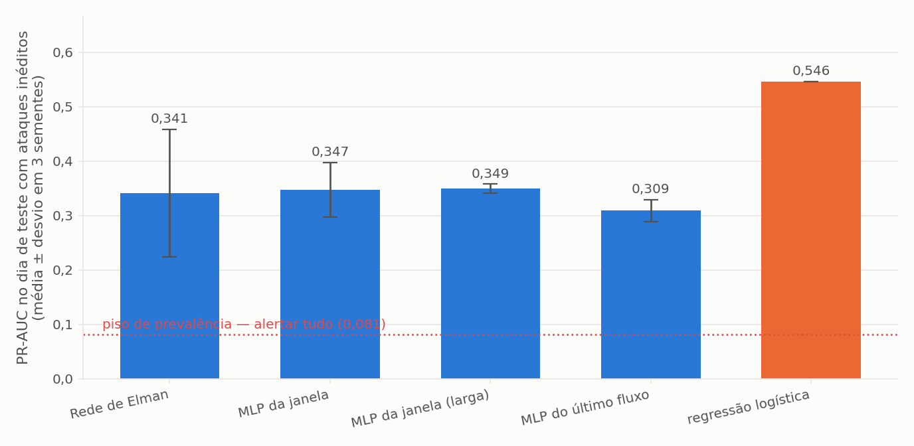
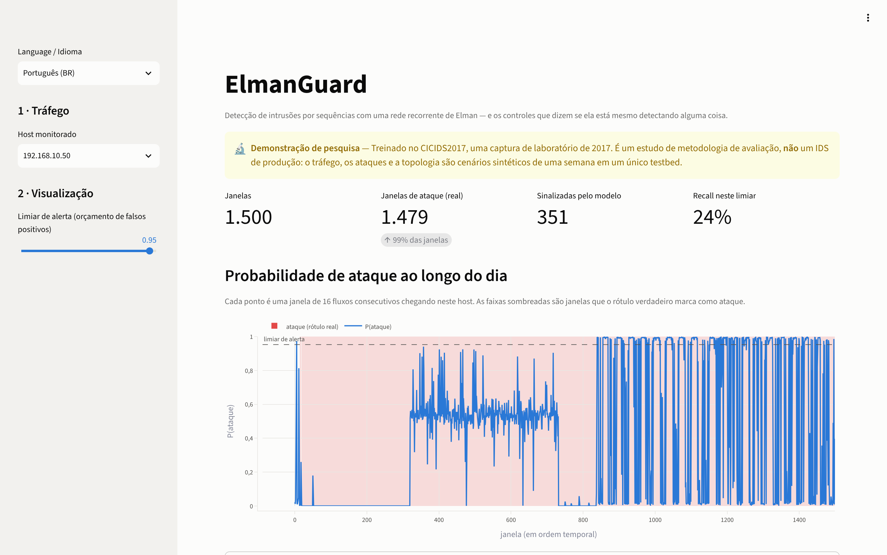
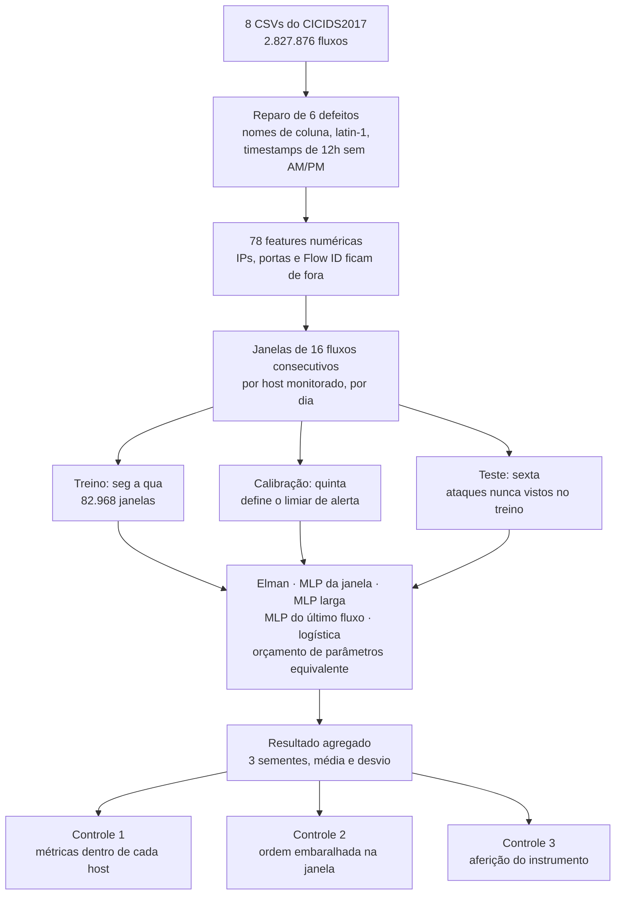
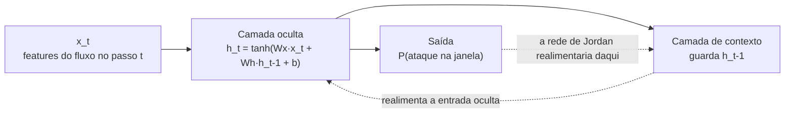
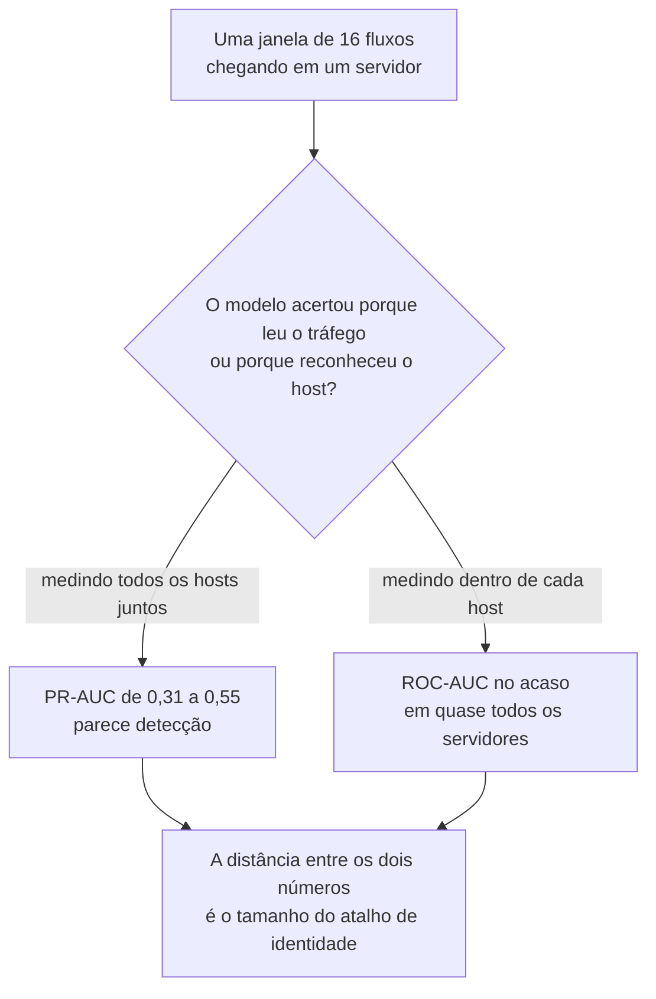
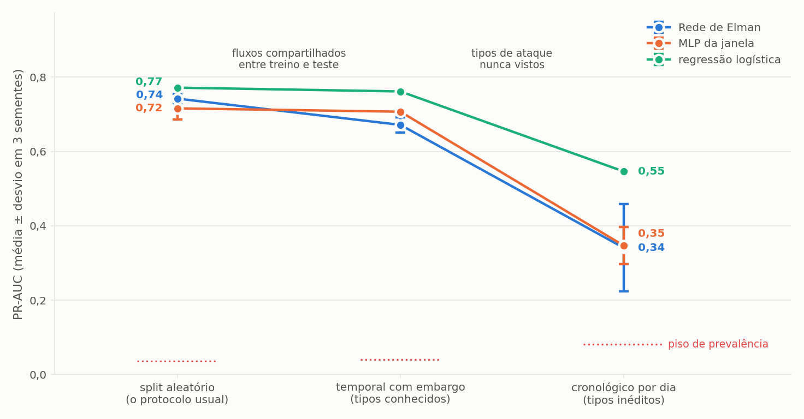
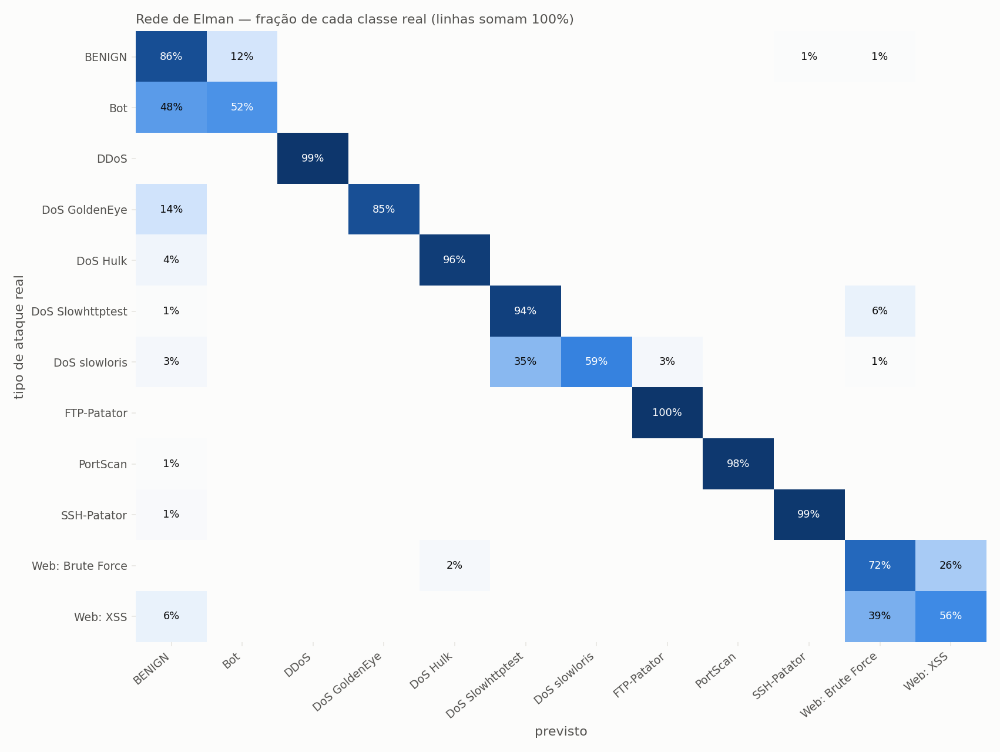

<h1 align="center">ElmanGuard</h1>

<p align="center">
  <strong>Detecção de intrusões por sequências com uma rede recorrente de Elman — e os controles que dizem se ela está mesmo detectando alguma coisa.</strong>
</p>

<p align="center">
  
  
  <a href="https://elman-guard-apps4fvjn5n5fsk4kb9v2wv.streamlit.app/"></a>
  
  
  <a href="https://github.com/AlanFMF/elman-guard/actions/workflows/tests.yml"></a>
</p>

<p align="center"><strong><a href="https://elman-guard-apps4fvjn5n5fsk4kb9v2wv.streamlit.app/">▶ Abrir o app online</a></strong> · <a href="README.en.md">🇺🇸 Read in English</a></p>

---

Uma rede de Elman lê uma janela de 16 fluxos de rede consecutivos chegando em um
servidor monitorado e prevê se aquela janela contém um ataque. Treinada de
segunda a quarta do CICIDS2017, com limiar definido na quinta e avaliada na
sexta — cujos tipos de ataque ela nunca viu.

O ponto do repositório não é o detector. São os quatro controles em volta dele, e
o que eles revelam.

## Cinco achados

**1 · Na detecção, a ordem temporal não carrega sinal mensurável — e esse nulo é crível.**
Embaralhar os fluxos dentro de cada janela destrói a ordem e preserva o conteúdo.
O PR-AUC do Elman cai **0,055**; o desvio-padrão da mesma medida entre sementes é
**0,117**. O efeito é menor que o ruído. O que torna isso digno de ser afirmado é
a aferição do instrumento, abaixo: o mesmo harness detecta um sinal temporal
*plantado* com PR-AUC 0,985.

**2 · Diante de um tipo de ataque inédito, o desempenho aparente é quase todo reconhecimento de host.**
Agregados entre servidores, os modelos chegam a PR-AUC 0,31–0,55. Calculados
*dentro* de cada host — onde "qual máquina é esta" não carrega informação —
todos os modelos neurais ficam no acaso ou abaixo dele. Só uma regressão
logística no servidor pesadamente atacado supera o acaso, com ROC-AUC 0,694.
**Com tipos de ataque já vistos, o veredito se inverte:** dentro do mesmo
servidor, a detecção é real, com ROC-AUC de 0,82 a 0,93.

**3 · Um modelo linear vence as redes neurais em todo protocolo testado.**
A regressão logística tem o maior PR-AUC nos três protocolos de detecção e o maior
F1 macro na multiclasse. Na detecção, as quatro redes ficam indistinguíveis entre
si — a diferença entre elas é menor que o desvio de uma só entre sementes.

**4 · O protocolo decide o número — e o vazamento é a menor parte da inflação.**
O split aleatório deixa fluxos do treino em 66% das janelas de teste, mas isso vale
só ~0,01 de PR-AUC para o MLP e a logística. O que infla de verdade é testar apenas
tipos de ataque conhecidos: de 0,21 a 0,36.

**5 · Para nomear o ataque, a Elman vence o MLP — mas não pela memória.**
Na multiclasse ela supera a contraparte sem recorrência por 0,08 de F1 macro, e a
vantagem sobrevive intacta quando a ordem dos fluxos é destruída. O que ela tem a
mais é compartilhar pesos ao longo da janela, não lembrar a sequência.



<details>
<summary><strong>O app</strong> (clique para expandir)</summary>



**[Abra o app](https://elman-guard-apps4fvjn5n5fsk4kb9v2wv.streamlit.app/)** e escolha outro servidor ou mude o limiar. Se ele
estiver dormindo (o plano gratuito desliga apps sem visita), clique para acordá-lo
e espere um minuto.

O dia de teste no servidor atacado. O dia inteiro está sombreado porque 98,6% das
suas janelas contêm tráfego de ataque — e a probabilidade do modelo passa longos
trechos perto de zero lá dentro. Essa imagem é o controle por host, desenhado.

</details>

## O experimento

| | |
|---|---|
| Dados | CICIDS2017 `TrafficLabelling`, os 8 arquivos, **2.827.876 fluxos** após reparo |
| Features | **78** estatísticas numéricas de fluxo; IPs, portas, `Flow ID` e timestamp excluídos |
| Amostra | 16 fluxos consecutivos chegando em um host monitorado, em um mesmo dia |
| Divisão | treino seg–qua (82.968 janelas, 3,2% ataque) · limiar qui (29.955, 1,1%) · teste sex (23.858, 8,1%) |
| Ataques do teste | PortScan, DDoS, Bot — **nenhum deles visto no treino** |
| Repetições | todo número abaixo é média ± desvio sobre 3 sementes |

## Arquitetura

O caminho que um fluxo de rede percorre até virar um número deste README:



| Etapa | O que acontece | Por que importa |
|---|---|---|
| Reparo | Seis defeitos dos CSVs publicados são corrigidos e testados | Sem isso o arquivo nem carrega direito, e dois deles corrompem o tempo |
| Features | IPs, portas, `Flow ID` e timestamp saem da matriz | Nesta captura o IP do atacante **é** o rótulo |
| Sequências | 16 fluxos consecutivos do mesmo host, no mesmo dia | Janela por host evita que a rede aprenda "que horas são"; nunca cruzar o dia evita vazamento no split |
| Divisão | Cronológica, por dia da semana | Cada dia tem ataques diferentes, então o teste mede generalização para tipos inéditos |
| Modelos | Cinco, com orçamento de parâmetros equivalente | Isola arquitetura de capacidade |
| Controles | Três, aplicados sobre o resultado | É o que separa detecção de reconhecimento, e sinal de ruído |

### A rede de Elman

A camada de contexto guarda a ativação da camada oculta do passo anterior e a
devolve como entrada extra. A rede de Jordan, sua irmã, realimenta a camada de
saída — a diferença está no ponto de onde parte a seta pontilhada:



### O atalho que os controles procuram

Quase todo ataque do CICIDS2017 parte de um único host e atinge um único
servidor. Isso abre um caminho pelo qual um modelo pontua bem sem detectar nada:



## Resultados

PR-AUC no dia de teste com ataques inéditos. O piso de prevalência — o que um
detector que alerta em tudo obteria — é 0,081.

| modelo | PR-AUC | ROC-AUC | recall a 1% FPR | precisão | params |
|---|---|---|---|---|---|
| **regressão logística** | **0,546** | 0,775 | **0,468** | 0,825 | 19.969 |
| MLP da janela (larga) | 0,349 ± 0,008 | 0,601 | 0,258 ± 0,019 | 0,822 | 80.001 |
| MLP da janela | 0,347 ± 0,050 | 0,603 | 0,155 ± 0,124 | 0,841 | 8.751 |
| **Elman RNN** | 0,341 ± 0,117 | 0,638 | 0,177 ± 0,097 | 0,815 | 9.217 |
| MLP do último fluxo | 0,309 ± 0,020 | 0,758 | 0,174 ± 0,056 | 0,767 | 9.201 |
| piso de prevalência | 0,081 | 0,500 | — | 0,081 | — |

Os quatro modelos neurais vão de 0,309 a 0,349 — uma faixa mais estreita que o
próprio desvio-padrão do Elman entre sementes. **Qualquer artigo que reporte que
sua RNN vence um MLP por dois pontos no CICIDS2017 está reportando a semente.**

O recall por tipo de ataque mostra de onde vem o 0,55:

| ataque (inédito) | Elman | MLP da janela | logística |
|---|---|---|---|
| DDoS | 0,530 | 0,684 | 0,808 |
| PortScan | 0,000 | 0,000 | 0,431 |
| Bot | 0,000 | 0,000 | 0,036 |

O DDoS transfere porque os dias de treino são cheios de DoS. PortScan e Bot não
transferem nada para os modelos neurais. É assim que "generalizar para tipos de
ataque inéditos" se parece de verdade.

## Os controles

### 1 · Dentro do host: quanto é reconhecimento?

Agregado entre servidores, um modelo pode pontuar bem apenas aprendendo *quais
máquinas são atacadas* — nesta captura o servidor web está sob ataque em 95% da
semana e os demais praticamente nunca. Dentro de um host essa informação é
constante, então os números por host medem detecção.

ROC-AUC, dia de teste, por host monitorado (0,5 = acaso):

| host | taxa de ataque | Elman | MLP da janela | logística |
|---|---|---|---|---|
| 192.168.10.50 | 98,6% | 0,561 | 0,451 | **0,694** |
| 192.168.10.9 | 13,8% | 0,426 | 0,399 | 0,509 |
| 192.168.10.15 | 8,0% | 0,483 | 0,340 | 0,328 |
| 192.168.10.5 | 4,9% | 0,417 | 0,360 | 0,415 |
| 192.168.10.14 | 4,3% | 0,316 | 0,192 | 0,303 |
| 192.168.10.8 | 3,5% | 0,464 | 0,266 | 0,341 |
| 205.174.165.73 | 56,9% | 0,220 | 0,100 | 0,195 |

Lendo a tabela: **o PR-AUC agregado de 0,34–0,55 é em grande parte identidade de
host.** Tirando isso, uma única célula supera o acaso.

### 2 · Embaralhamento da ordem: a recorrência se paga?

| modelo | PR-AUC ordenado | PR-AUC embaralhado | queda | desvio entre sementes |
|---|---|---|---|---|
| Elman RNN | 0,341 ± 0,117 | 0,286 ± 0,039 | 0,055 | 0,117 |
| MLP da janela | 0,347 ± 0,050 | 0,305 ± 0,024 | 0,042 | 0,050 |

As duas quedas são menores que a dispersão entre execuções. No nível de janela de
fluxos desta captura, a ordem não carrega informação que os modelos consigam usar.

### 3 · A aferição do instrumento — o controle que salvou o projeto

Um resultado nulo não vale nada se o instrumento não é capaz de detectar um
positivo. O `synthetic.order_only_dataset` monta janelas em que **a ordem é o
único sinal**: toda janela vem do mesmo processo AR(1), e as negativas são os
mesmos valores permutados no tempo — então média, variância, mínimo, máximo e até
a distribuição do último passo são idênticas entre as classes.

| configuração | PR-AUC na sonda de ordem pura |
|---|---|
| padrão anterior (48 units, dropout 0,3, lr 1e-3) | **0,483** — acaso |
| padrão atual (64 units, dropout 0,2, lr 3e-3) | **0,985** |

A primeira configuração teria produzido uma conclusão confiante, publicada e
completamente falsa: *"a recorrência não acrescenta nada"*. Não era um achado,
era uma rede subtreinada. A sonda hoje é um teste
(`tests/test_harness_detects_planted_signal.py`) que falha se o harness perder a
capacidade de enxergar um efeito temporal.

Um segundo bug de reprodutibilidade apareceu do mesmo jeito: semear dentro do
`fit`, mas não antes de os pesos serem criados, fazia duas execuções da mesma
configuração diferirem em mais de 0,25 de PR-AUC. Daí três sementes em todo
número.

### 4 · Agrupar por origem em vez de destino

Quase todo fluxo de ataque do CICIDS2017 parte de um host, `172.16.0.1`, cujo
tráfego é **99,4% ataque**. Agrupar as sequências por origem transforma a pergunta,
silenciosamente, em "esta é a máquina do atacante?". Medido, execução única:

| agrupamento | PR-AUC | precisão |
|---|---|---|
| por destino (servidor monitorado) | 0,470 | 0,815 |
| por origem | 0,291 | **1,000** |

Eu esperava que agrupar por origem inflasse o PR-AUC, e não inflou; o que ele faz
é empurrar a precisão para 1,000 exatos, que é a assinatura de um modelo que
achou um atalho de identidade e só dispara quando tem certeza. Reportado como
medido, não como previsto.

## O protocolo decide o número

Os mesmos modelos, nas mesmas janelas, avaliados de três jeitos:

| protocolo | o que separa treino e teste | janelas de teste com fluxo do treino |
|---|---|---|
| **aleatório** | janelas embaralhadas — o protocolo da maioria dos resultados publicados | **66%** |
| **temporal com embargo** | cada rajada de ataque cortada no tempo; toda janela que compartilha um fluxo através da fronteira é descartada | 0% |
| **cronológico** | treino de segunda a quarta, teste na sexta | 0%, por construção |



| modelo | aleatório | temporal | cronológico |
|---|---|---|---|
| regressão logística | 0,772 | 0,761 | 0,546 |
| Rede de Elman | 0,742 ± 0,012 | 0,671 ± 0,021 | 0,341 ± 0,117 |
| MLP da janela | 0,716 ± 0,029 | 0,707 ± 0,005 | 0,347 ± 0,050 |
| piso de prevalência | 0,035 | 0,040 | 0,081 |

**A inflação tem duas causas, e a mais citada é a menor.** O vazamento é real —
dois terços das janelas de teste do split aleatório contêm ao menos um fluxo que o
modelo viu no treino — mas custa pouco: cerca de 0,01 de PR-AUC para o MLP e para a
logística. O degrau grande é o seguinte. Testar só tipos de ataque que o modelo já
conhece, em vez de tipos inéditos, vale de **0,21 a 0,36**. Um split aleatório no
CICIDS2017 não mede detecção de intrusão; mede reconhecimento de ataques catalogados.

**A rede recorrente é a que mais lucra com o vazamento.** Quando o embargo entra, a
Elman perde 0,07 — cerca de três desvios-padrão, enquanto a queda do MLP fica dentro
do ruído. Janelas sobrepostas compartilham uma sequência de oito fluxos, e o modelo
que lê sequências é justamente o que mais se beneficia de já tê-la visto.

**E o controle por host muda de veredito.** Dentro do servidor atacado
(`192.168.10.50`), com tipos de ataque conhecidos, a detecção é real: ROC-AUC de
0,82 (Elman), 0,84 (MLP) e 0,93 (logística). Com tipos inéditos, cai para 0,56, 0,45
e 0,69. Ou seja: a conclusão de que "o desempenho é reconhecimento de host" vale para
ataques nunca vistos. Quando o tipo já é conhecido, os modelos leem o tráfego.

O que o protocolo temporal **não** garante: ele não é cronológico entre classes.
Tráfego benigno do fim de um dia pode treinar um modelo testado num ataque do
começo do mesmo dia. Ele garante que nenhum fluxo é visto dos dois lados — e que,
dentro de cada tipo de ataque, o teste vem depois do treino.

## Multiclasse: qual ataque é?

Detectar responde "há algo errado nesta janela?". A pergunta seguinte de quem
opera um IDS é *o quê*. A disciplina é a mesma do binário: orçamento de
parâmetros equivalente, três sementes, baseline linear e ablação de ordem.

Duas escolhas são forçadas pelos dados:

- **O protocolo é o temporal com embargo.** No cronológico, o dia de teste só tem
  tipos nunca vistos no treino — e nenhum classificador nomeia uma classe que
  nunca lhe foi mostrada.
- **O limite de janelas é aplicado por tipo de ataque.** Com o limite
  proporcional usado na detecção, um ataque minoritário num servidor movimentado
  ficava com poucas dezenas de janelas. Mesmo assim, três tipos não chegam ao
  mínimo de 60 — Heartbleed (5 janelas), Infiltration (5) e SQL Injection (6) — e
  ficam fora da tarefa, listados no relatório.

São **12 classes** — tráfego benigno e 11 tipos de ataque — e nenhuma janela de
teste compartilha fluxo com o treino. A métrica principal é o **F1 macro**, em que
todo tipo pesa igual: não dá para pontuar bem acertando só o benigno e o DoS Hulk.

| modelo | F1 macro | acurácia balanceada | F1 ponderado |
|---|---|---|---|
| regressão logística | **0,749** | 0,788 | 0,960 |
| Rede de Elman | 0,711 ± 0,022 | **0,843 ± 0,012** | 0,926 ± 0,011 |
| MLP da janela | 0,630 ± 0,022 | 0,807 ± 0,009 | 0,914 ± 0,006 |



**Aqui a rede recorrente vence a sua contraparte sem recorrência** — por 0,08 de
F1 macro, quase quatro desvios-padrão, com o mesmo orçamento de parâmetros. É a
primeira tarefa deste projeto em que isso acontece.

**Mas não é por causa da ordem.** Embaralhar os fluxos dentro de cada janela não
derruba a Elman — e a vantagem sobre o MLP sobrevive inteira:

| modelo | F1 macro, ordem real | F1 macro, ordem embaralhada | diferença |
|---|---|---|---|
| Rede de Elman | 0,711 ± 0,022 | 0,722 ± 0,013 | +0,011 |
| MLP da janela | 0,630 ± 0,022 | 0,607 ± 0,039 | −0,023 |

As duas diferenças ficam dentro do ruído. O que é compatível com isso é uma
explicação estrutural, não temporal: a camada recorrente aplica **os mesmos pesos**
a cada um dos 16 fluxos, enquanto o MLP achatado, com o mesmo orçamento, precisa
aprender pesos separados para cada posição — e fica com só 8 unidades ocultas para
isso. A Elman ganha por *compartilhar* pesos ao longo da janela, não por *lembrar*
a sequência. É uma hipótese: a ablação descarta a ordem como causa, mas não testa o
compartilhamento diretamente.

**A logística ainda tem o maior F1 macro, mas a Elman acerta mais de cada
classe.** A acurácia balanceada é a média do recall por classe, e nela a Elman
lidera (0,843 contra 0,788). O F1 macro pune também a precisão, e é aí que ela
perde: 12% das janelas benignas viram "Bot". Com 23 mil janelas benignas no teste
e só 67 de Bot, esses alarmes falsos afogam a classe inteira — o Bot tem F1 de
0,03 em todos os modelos.

**Os erros acontecem onde um analista esperaria.** Fora o Bot, que se mistura ao
tráfego normal, e o GoldenEye, que em 14% das janelas é lido como benigno, as
confusões ficam dentro da mesma família de ataque:

- **slowloris → Slowhttptest (35%)**. Os dois são DoS "lentos": seguram conexões
  HTTP abertas com pouquíssimo tráfego. No nível de fluxo, são quase o mesmo gesto.
- **Força bruta web ↔ XSS (26% e 39%)**. Os dois atacam a mesma aplicação web,
  pela mesma porta, com requisições HTTP parecidas.
- **Bot ↔ benigno (48%)**. Metade do Bot passa por tráfego normal — que é
  exatamente o que um bot bem feito tenta parecer.

O modelo erra a espécie com muito mais frequência do que erra o gênero. F1 por
tipo de ataque, média das três sementes:

| tipo de ataque | Elman | MLP da janela | logística |
|---|---|---|---|
| benigno | 0,934 | 0,929 | 0,969 |
| DDoS | 0,988 | 0,944 | 0,992 |
| PortScan | 0,988 | 0,953 | 0,986 |
| FTP-Patator | 0,953 | 0,857 | 0,981 |
| DoS GoldenEye | 0,882 | 0,763 | 0,900 |
| DoS Hulk | **0,838** | 0,671 | 0,766 |
| SSH-Patator | 0,709 | 0,592 | 0,878 |
| DoS Slowhttptest | 0,674 | 0,634 | 0,715 |
| DoS slowloris | 0,643 | 0,555 | 0,697 |
| Web: XSS | **0,451** | 0,431 | 0,426 |
| Web: força bruta | 0,441 | 0,199 | 0,642 |
| Bot | 0,029 | 0,031 | 0,033 |

## Método

Detalhe completo em [`docs/how_it_works.pt.md`](docs/how_it_works.pt.md). Em resumo:

**O parser corrige seis defeitos documentados** dos CSVs publicados — espaços à
esquerda em 70 dos 85 nomes de coluna, bytes latin-1 nos rótulos de web attack,
linhas de cabeçalho no meio do arquivo, 288.602 linhas vazias de preenchimento,
timestamps de 12 horas sem marcador AM/PM (`1:02` é 13:02) e ordem dia/mês
ambígua, resolvida conferindo o dia da semana contra o nome do arquivo. Cada um
tem teste.

**Linhas duplicadas são mantidas, de propósito.** Remover duplicatas é o conselho
padrão e vem do enquadramento de classificação de linhas. Aqui a divisão é
cronológica, então duplicatas não atravessam a fronteira — e uma força bruta *é*
uma sequência de fluxos quase idênticos. Removê-las apagaria o sinal. A contagem
é reportada em vez disso.

**Janelas nunca cruzam host nem dia**, então o split por dia da semana não pode
colocar os mesmos fluxos dos dois lados.

**Toda arquitetura recebe orçamento de parâmetros equivalente**, porque uma janela
achatada de 16 passos é 16× mais larga que um passo e uma camada densa sem esse
ajuste venceria por capacidade, não por arquitetura. O `window_mlp_wide` é o
controle deliberadamente superdimensionado, com 9× os parâmetros.

**O early stopping observa janelas retidas dos dias de treino**, não o dia de
calibração. Cada dia da semana tem ataques diferentes, então um sinal de validação
de outro dia mede transferência, não convergência, e o treino para no ruído.

```
Entrada (16, 78) → SimpleRNN(64, tanh) → Dropout(0,2) → Dense(1, sigmoid)
9.217 parâmetros · entropia cruzada binária · Adam 3e-3 · com peso de classe
```

## Como rodar

Para só usar o app, não precisa instalar nada: [abra a versão online](https://elman-guard-apps4fvjn5n5fsk4kb9v2wv.streamlit.app/).

O CICIDS2017 não é redistribuível, então a captura bruta não está no repositório.

```bash
git clone https://github.com/AlanFMF/elman-guard.git
cd elman-guard
python -m venv .venv && source .venv/bin/activate   # Windows: .venv\Scripts\activate
pip install -r requirements-dev.txt

pytest -m "not slow"        # 41 testes, sem precisar do dataset
pytest                      # 45: inclui as aferições do instrumento, que treinam modelos pequenos
streamlit run app.py        # abre com o modelo treinado e uma amostra do dia de teste
```

O `requirements.txt` tem só o que o app precisa — é o que o Streamlit Cloud
instala. O `requirements-dev.txt` acrescenta pytest e matplotlib. Python 3.11,
verificado também em 3.12.

Os 45 testes rodam no **GitHub Actions** a cada push, em dois estágios: primeiro
os rápidos; depois, só se eles passarem, os que treinam modelos e aferem o
próprio harness. O selo no topo deste README é o resultado da última execução.

Com os dados (baixe o `GeneratedLabelledFlows.zip` do
[CIC](https://www.unb.ca/cic/datasets/ids-2017.html) — **não** a versão
`MachineLearningCVE`, que teve as colunas de IP e timestamp removidas e não
permite formar sequências):

```bash
python scripts/prepare_data.py --raw caminho/para/TrafficLabelling --out data/processed

python scripts/run_experiment.py --split chronological            # tipos de ataque inéditos
python scripts/run_experiment.py --split temporal --models elman window_mlp \
       --skip-ablation --skip-grouping-experiment                  # tipos conhecidos, com embargo
python scripts/run_experiment.py --split random --models elman window_mlp \
       --skip-ablation --skip-grouping-experiment                  # o protocolo inflado
python scripts/run_multiclass.py                                   # qual ataque é

python scripts/export_demo.py
python scripts/make_figures.py
```

O app é bilíngue e mostra a probabilidade de ataque ao longo do dia de teste para
um servidor escolhido, com os períodos de ataque reais sombreados, ao lado de
todos os resultados medidos acima.

## Limitações

- **Uma semana, um testbed, 2017.** O tráfego é gerado, os ataques são
  roteirizados e a topologia é fixa. Nada aqui transfere para uma rede real sem
  nova medição.
- **Defeitos conhecidos do dataset.** Além dos seis que o parser corrige, há
  trabalho publicado documentando erros de rotulagem e um bug de construção de
  fluxos no CICFlowMeter usado para gerar estes CSVs. Existe uma re-publicação
  corrigida; este projeto usa a original, então os números absolutos carregam essa
  ressalva.
- **A janela tem 16 fluxos.** Um ataque lento espalhado por horas pode
  simplesmente não caber no contexto. Janelas maiores não foram varridas.
- **Três sementes** bastam para mostrar que as diferenças são ruído, mas não para
  resolver diferenças reais pequenas.
- **Divisão disjunta por host continua impossível.** Três protocolos foram
  comparados, mas nenhum separa máquinas: um único host envia quase todo o
  tráfego de ataque, então ele só pode estar de um lado.
- **A multiclasse exclui três tipos de ataque.** Heartbleed, Infiltration e SQL
  Injection têm de 5 a 6 janelas na captura inteira — não há como aprender nem
  avaliar com isso. Eles aparecem listados no relatório, não escondidos.

### O que eu tentaria a seguir

Um modelo que aplique a mesma camada a cada fluxo e faça a média (um *Deep Sets*),
que é o teste direto da hipótese de que a vantagem da Elman na multiclasse vem do
compartilhamento de pesos e não da memória. Depois: janelas mais longas e
multiescala; um modelo de linha de base por host, para que
a pontuação seja "incomum *para este servidor*" em vez de "incomum"; e a
re-publicação corrigida do CICIDS2017, para ver quais destes achados sobrevivem a
rótulos melhores.

## ⚠️ Aviso

Demonstração de pesquisa sobre metodologia de avaliação de modelos sequenciais,
**não** um sistema de detecção de intrusões de produção. Não implante em rede real.

## Licença

MIT — veja [LICENSE](LICENSE).
